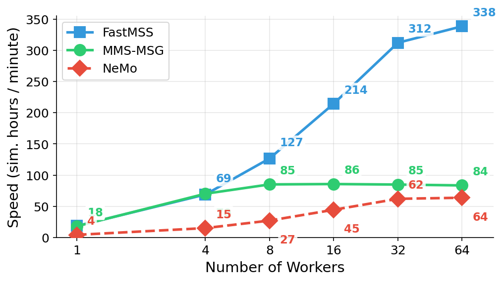

# FastMSS: Fast Multi-Speaker Simulation

FastMSS generates realistic multi-speaker meetings with exact labels (Lhotse
manifests + RTTM) for speaker diarization, multi-talker / speaker-attributed
ASR, and speech separation. It has two generators that share one turn-taking
model and one mixing/acoustics engine:

| | **TTS meetings** (`recipes/tts_staged.py`) | **Concatenative meetings** (`recipes/sim.py`) |
|---|---|---|
| speech | synthesised by CosyVoice 3, cloning LibriSpeech voices | real utterances cut from a Lhotse corpus |
| content | one coherent LLM-written conversation per meeting | unrelated utterances |
| labels | per-turn text, delivery instruction, level, event type | per-utterance text |
| speed | GPU-bound (TTS) | CPU, very fast |

The TTS path is **timing-first**: an HMM samples who speaks when (turns, holds,
interruptions, backchannels, and their word budgets) *before* any text exists;
an LLM then writes personas and dialogue that fit that timing, and CosyVoice
renders each line from a reference clip of the speaker's LibriSpeech voice:

```
HMM skeleton ──► scenario + voices ──► LLM cast & fill ──► CosyVoice 3 ──► placement ──► FastMSS mix
(timing, events)  (LibriSpeech bank)   (personas, lines,   (one clip per   (measured     (gain, RIR, noise,
                                        delivery, level)    utterance)      durations)    Lhotse + RTTM)
```

On top of a generated corpus, two recipes produce matched variants without
re-running TTS: a **Shuffled-Turn** semantic ablation (same voices, timing and
events, but turns reassigned across meetings so the discourse no longer makes
sense) and **acoustic augmentation** (simulated rooms and real/Gaussian noise).

- [Installation](#installation)
- [Recipes at a glance](#recipes-at-a-glance)
- [TTS meetings: `tts_staged.py`](#tts-meetings-tts_stagedpy)
- [Single-pass TTS: `tts_sim.py`](#single-pass-tts-tts_simpy)
- [Shuffled-Turn ablation](#shuffled-turn-ablation-derive_shuffled_turnspy)
- [Acoustic augmentation](#acoustic-augmentation-augment_tts_acousticspy)
- [End-to-end example](#end-to-end-example-a-notsofar-like-corpus-and-its-variants)
- [Output layout](#output-layout)
- [Concatenative simulation: `sim.py`](#concatenative-simulation-simpy)

## Installation

```bash
git clone https://github.com/popcornell/FastMSS.git
cd FastMSS
pip install -e .
```

The TTS recipes additionally need three things outside this repo; all are
described step by step in [docs/tts.md](docs/tts.md):

1. **CosyVoice 3** in its own conda env (it pins an older torch), plus the
   `Fun-CosyVoice3-0.5B` weights. FastMSS talks to it through a subprocess.
2. **LibriSpeech**: the source of reference voices.
3. **An LLM endpoint**: Ollama by default (`qwen3:30b-a3b`), or any
   OpenAI-compatible server (vLLM, SGLang, ...).

```bash
export COSYVOICE_REPO=$HOME/CosyVoice                         # default lookup: ~/CosyVoice
export COSYVOICE_PYTHON=$HOME/miniconda3/envs/cosyvoice/bin/python
export LIBRISPEECH_ROOT=/path/to/LibriSpeech
ollama serve & ollama pull qwen3:30b-a3b
```

Check the installation without an LLM (stub dialogue, real TTS and mixing):

```bash
python recipes/tts_staged.py --no-llm --n 1 --duration 15 --tts-gpu 0 --out exp/smoke
```

## Recipes at a glance

| script | purpose |
|---|---|
| `recipes/tts_staged.py` | **Main TTS generator.** Text phase (LLM) and TTS phase (CosyVoice) run separately; NOTSOFAR-like specs, parallel TTS workers, resume, corpus extension. |
| `recipes/tts_sim.py` | Minimal single-pass TTS generator (LLM and TTS interleaved per meeting). |
| `recipes/derive_shuffled_turns.py` | Derive a Shuffled-Turn ablation from a finished dry TTS corpus; can also (re)create speaker stems. |
| `recipes/validate_shuffled_turns.py` | Check a Shuffled-Turn corpus against its source and report the differences. |
| `recipes/augment_tts_acoustics.py` | Add simulated RIRs and/or noise to a dry TTS corpus as a separate variant. |
| `recipes/sim.py` | Original concatenative simulator (Hydra config). |

Every script prints all of its options with `--help`.

## TTS meetings: `tts_staged.py`

A run has two phases:

1. **text**: for each meeting, sample the HMM skeleton, the voices and a
   scenario, then ask the LLM for a premise, personas and every line. Plans
   are saved to `manifests/tts-text-plans.jsonl` and
   `manifests/<id>_text.json`.
2. **tts**: unload the Ollama model (so the GPU is free), start CosyVoice,
   synthesise every saved plan, place the clips on the timeline, mix, and write
   the manifests.

`--phase all` (default) runs both. Every stage can be resumed:
- existing text plans are reused;
- `--resume-tts` skips finished meetings;
- synthesised clips are cached in `clips_native/` by (text, instruction,
  voice), so a re-run never renders the same line twice.

### Basic runs

```bash
# 10 meetings x 30 s, 3 speakers, everything in one go on GPU 1
python recipes/tts_staged.py --phase all \
  --n 10 --duration 30 --speakers 3 \
  --model qwen3:30b-a3b --base-url http://127.0.0.1:11434/v1 \
  --tts-gpu 1 --tts-jobs 2 --cosyvoice-fp16 \
  --out exp/tts_staged

# the same, with the phases run by hand
python recipes/tts_staged.py --phase text --n 10 --duration 30 --speakers 3 --out exp/tts_staged
ollama stop qwen3:30b-a3b
python recipes/tts_staged.py --phase tts --tts-gpu 1 --tts-jobs 2 --cosyvoice-fp16 --out exp/tts_staged

# debug the LLM output for a single short meeting, regenerating its plan
python recipes/tts_staged.py --phase text --n 1 --duration 15 --overwrite-text --out exp/debug_llm
```

### Long meetings

The dialogue is written in chunks of `--fill-chunk` slots. If long meetings
fail with `LLM output hit max_tokens`, use smaller chunks and/or raise the
output budgets:

```bash
python recipes/tts_staged.py --phase all \
  --n 10 --duration 120 --speakers 3 \
  --fill-chunk 6 --llm-cast-max-tokens 2800 --llm-fill-max-tokens 4000 \
  --tts-gpu 1 --tts-jobs 4 --cosyvoice-fp16 \
  --out exp/long_meetings
```

### NOTSOFAR-like meetings

`--notsofar-like` samples a duration and a speaker count for each meeting:
- **Durations** are log-normal, spread set by `--duration-cv`, bounded by
  `--duration-min/--duration-max` (default 0.45x to 1.8x the mean). With
  `--total-duration` they are rescaled to sum to exactly that.
- **Speaker counts** follow a Poisson(`--speaker-lambda`=4) truncated to
  `--speakers-min`..`--speakers-max` (default 3..8). That gives roughly
  26/26/21/14/8/4 % for 3..8 speakers.

```bash
# 10 meetings whose planned durations sum to exactly one hour
python recipes/tts_staged.py --phase all \
  --n 10 --total-duration 3600 --notsofar-like \
  --fill-chunk 6 --llm-cast-max-tokens 1800 --llm-fill-max-tokens 3000 \
  --tts-gpu 1 --tts-jobs 4 --cosyvoice-load-trt --cosyvoice-trt-concurrent 1 \
  --out exp/notsofar_like_1h
```

The voice bank comes from LibriSpeech `train-clean-100` (251 speakers). The
default `--bank-limit 60` keeps only the first 60; for big corpora pass a
large value (e.g. `10000`, meaning all of them) so meetings don't keep reusing
the same handful of voices. The bank is cached in `<out>/bank.json` by the
first run, so `--bank-limit` has no effect on an existing corpus.

### Growing a corpus, and resuming

Meetings are named `ttsmeeting_<index>` with a global index, and every
per-meeting seed is `--seed + index`. `--append` adds a batch after the last
existing meeting:
- it records the batch in `manifests/generation-state.json` before starting;
- it never reuses a complete scenario tuple already in the corpus;
- it rebuilds the combined manifests over old and new meetings at the end.

If the run is interrupted, **repeat the exact same command**: it resumes the
active batch (with `--resume-tts`). Keep `--seed` equal to the corpus's
original seed; a different `--seed`, `--n` or `--total-duration` is rejected
while a batch is active.

```bash
# add 1,500 NOTSOFAR-like meetings (150 h planned) to an existing corpus
nohup python recipes/tts_staged.py --phase all --append \
  --n 1500 --total-duration 540000 --notsofar-like \
  --speakers-min 3 --speakers-max 8 --speaker-lambda 4.0 \
  --bank-limit 10000 --seed 0 \
  --tts-gpu 1 --tts-jobs 4 --cosyvoice-fp16 \
  --out $CORPUS > $CORPUS/batch2.log 2>&1 &

# resume an interrupted TTS phase (Ollama already stopped)
python recipes/tts_staged.py --phase tts --resume-tts --skip-ollama-stop \
  --tts-gpu 1 --tts-jobs 4 --cosyvoice-fp16 --cosyvoice-retries 3 --out $CORPUS

# synthesise only meetings 1500..2999, e.g. from a second process or machine
python recipes/tts_staged.py --phase tts --start-index 1500 --n 1500 --resume-tts \
  --tts-gpu 0 --tts-jobs 4 --cosyvoice-fp16 --out $CORPUS
```

When two processes synthesise different ranges, whichever finishes first
reports the other range as incomplete when it rebuilds the combined
manifests. Its own meetings are already saved, though. Once both are done,
run `--phase tts --resume-tts` once to write the combined manifests.

### Speed tuning

Each `--tts-jobs` worker loads its own copy of CosyVoice, which uses about
7–8 GB of VRAM. Two to four workers fit on a 48 GB card once the LLM has been
unloaded. One process drives one GPU: `--tts-gpu 0,1` would still put every
worker on the first visible device, so use one process per GPU with
`--start-index` ranges instead. Change one acceleration setting at a time:

```bash
# known-good baseline: fp16
python recipes/tts_staged.py --phase tts --tts-gpu 1 --tts-jobs 4 --cosyvoice-fp16 --out exp/x

# skip CosyVoice's text normalisation (the LLM output is already plain English)
python recipes/tts_staged.py --phase tts --tts-gpu 1 --tts-jobs 4 --cosyvoice-fp16 \
  --cosyvoice-no-text-frontend --out exp/x

# TensorRT: the first launch builds the .plan engine, so start with one worker
python recipes/tts_staged.py --phase tts --tts-gpu 1 --tts-jobs 1 \
  --cosyvoice-load-trt --cosyvoice-trt-concurrent 2 --out exp/x

# vLLM: needs vllm in the cosyvoice env and a vllm/ export in the model dir
python recipes/tts_staged.py --phase tts --tts-gpu 1 --tts-jobs 1 --cosyvoice-load-vllm --out exp/x
```

Before starting CosyVoice the script waits until `ollama ps` lists no
resident models. `--allow-other-ollama-models` only requires *your* model to
unload; `--skip-ollama-stop` leaves Ollama alone entirely.

### Acoustics during mixing

```bash
python recipes/tts_staged.py --phase all --n 5 --duration 30 \
  --reverberate --add-noise --noise-folder /path/to/wham_noise \
  --tts-gpu 1 --tts-jobs 4 --cosyvoice-fp16 --out exp/noisy_reverb
```

`--add-noise` without `--noise-folder` adds Gaussian noise. For large corpora,
prefer generating a dry corpus and adding acoustics afterwards with
[`augment_tts_acoustics.py`](#acoustic-augmentation-augment_tts_acousticspy).
That way one TTS run yields any number of acoustic variants, and the
Shuffled-Turn ablation can get exactly the same treatment.

### Options

| group | option | default | meaning |
|---|---|---|---|
| general | `--phase {all,text,tts}` | `all` | which phase(s) to run |
| | `--out` | `exp/tts_staged` | corpus directory |
| | `--seed` | `0` | corpus base seed (meeting *i* uses seed + *i*) |
| specs | `--n` | `2` | meetings to generate / synthesise |
| | `--duration` | `30` | per-meeting (or mean) duration, s |
| | `--total-duration` | – | exact sum of planned durations, s |
| | `--randomize-duration`, `--duration-cv`, `--duration-min/max` | off, 0.35 | log-normal per-meeting durations |
| | `--speakers` | `3` | fixed speaker count |
| | `--randomize-speakers`, `--speakers-min/max`, `--speaker-lambda` | off, 3, 8, 4.0 | truncated-Poisson speaker counts |
| | `--notsofar-like` | off | both randomisations |
| text | `--librispeech` | `$LIBRISPEECH_ROOT` | voice-bank source |
| | `--bank-limit` | `60` | max voices in the bank |
| | `--model`, `--base-url` | `qwen3:30b-a3b`, Ollama | LLM |
| | `--fill-chunk` | `12` | slots per fill call |
| | `--llm-max-tokens`, `--llm-cast-max-tokens`, `--llm-fill-max-tokens` | 1200, auto, 1600 | output budgets |
| | `--convo-type` | weighted draw | force a scenario type |
| | `--no-llm` | off | stub dialogue (smoke test) |
| | `--overwrite-text` | off | regenerate existing plans |
| extend/resume | `--append` | off | add a new batch after existing meetings |
| | `--start-index` | – | first global index (with `--phase tts`: synthesise a range) |
| | `--unique-scenarios` | off (on with `--append`) | never reuse a scenario tuple |
| | `--resume-tts` | off | skip finished meetings |
| acoustics | `--reverberate`, `--add-noise`, `--noise-folder` | off | in-mix RIR / noise |
| Ollama | `--skip-ollama-stop`, `--allow-other-ollama-models`, `--ollama-stop-timeout` | off, off, 20 | LLM unload before TTS |
| CosyVoice | `--tts-gpu` | – | sets `CUDA_VISIBLE_DEVICES` |
| | `--tts-jobs` | `1` | parallel workers (one model copy each) |
| | `--cosyvoice-fp16`, `--cosyvoice-load-trt`, `--cosyvoice-trt-concurrent`, `--cosyvoice-load-vllm`, `--cosyvoice-no-text-frontend` | off, off, 1, off, off | acceleration |
| | `--cosyvoice-retries` | `3` | attempts per utterance (worker restarted on crash) |

LLM sampling (`FASTMSS_LLM_TEMPERATURE`, `FASTMSS_LLM_TOP_P`) and the
CosyVoice paths are set through environment variables; see
[docs/tts.md](docs/tts.md).

## Single-pass TTS: `tts_sim.py`

The simplest entry point: for each meeting in turn, the LLM writes it and
CosyVoice renders it, so both must fit in memory together. It has no resume,
specs or parallelism; use it for quick experiments.

```bash
python recipes/tts_sim.py --n 2 --duration 30 --speakers 3 \
  --librispeech $LIBRISPEECH_ROOT --model qwen3:30b-a3b --out exp/tts_sim
python recipes/tts_sim.py --n 1 --duration 15 --speakers 2 --no-llm --out exp/tts_smoke
```

## Shuffled-Turn ablation: `derive_shuffled_turns.py`

This builds a semantically incoherent twin of a dry TTS corpus. Each meeting
keeps its voices, slots, event types and target speech levels. Each turn's
audio and transcript are replaced by a different turn, drawn from another
meeting where possible, that has the same clone voice and event type, the
same delivery level where possible, and a similar duration. Every source turn
is used exactly once and never maps to itself; the mapping is deterministic
in `--seed`.

`--timing-mode gaps-overlaps` (default) re-flows the timeline so the source
pauses and overlaps are preserved even though the donor turns have different
durations. `fixed-onsets` keeps the original start times instead.

```bash
# check the source and print mapping statistics without writing anything
python recipes/derive_shuffled_turns.py --source $CORPUS --out $CORPUS_shuffled --seed 1729 --dry-run

# derive the ablation (mixtures + manifests only)
python recipes/derive_shuffled_turns.py --source $CORPUS --out $CORPUS_shuffled \
  --seed 1729 --timing-mode gaps-overlaps --duration-block-size 8 --jobs 4

# same, but also write per-speaker stems (needed for augment_tts_acoustics.py)
python recipes/derive_shuffled_turns.py --source $CORPUS --out $CORPUS_shuffled \
  --seed 1729 --jobs 4 --write-stems

# add stems to an existing shuffled corpus; each is verified to sum back to the mixture
python recipes/derive_shuffled_turns.py --source $CORPUS --out $CORPUS_shuffled \
  --write-stems-only --jobs 1 --resume

# derive one split only (turns are shuffled within the split, so nothing leaks across splits)
python recipes/derive_shuffled_turns.py --source $CORPUS --out $CORPUS_shuffled_dev \
  --recording-ids dev_ids.txt --seed 1729
```

| option | default | meaning |
|---|---|---|
| `--source`, `--out` | required | dry source corpus; new output dir (must differ) |
| `--seed` | `0` | shuffle seed |
| `--duration-block-size` | `8` | turns per duration-matched shuffle block (smaller = closer durations) |
| `--timing-mode` | `gaps-overlaps` | or `fixed-onsets` |
| `--limit N` / `--recording-ids FILE` | all | first N meetings / an explicit split |
| `--write-stems` / `--write-stems-only` | off | write stems / only recover stems |
| `--jobs` | `1` | parallel CPU mixing threads |
| `--resume` | off | skip finished meetings (refuses a changed configuration) |
| `--dry-run` | off | validate + map, write nothing |

The source must have been generated without in-mix acoustics, because the
script works from the dry per-turn clips in `clips_final/`. It checks free
disk space before writing.

### Validation: `validate_shuffled_turns.py`

```bash
python recipes/validate_shuffled_turns.py --source $CORPUS --shuffled $CORPUS_shuffled \
  --check-audio --report-json $CORPUS_shuffled/manifests/validation.json
```

The script fails if any structural guarantee is broken (one-to-one mapping,
no identity donors, voice and event preserved, consistent durations and
onsets). It then reports what differs by design: rendered and speech
duration, same-meeting donors, level mismatches, and the pause/overlap
re-flow error.

## Acoustic augmentation: `augment_tts_acoustics.py`

This turns a dry corpus (original or shuffled) into an acoustic variant. Each
speaker's stem is convolved with its own simulated RIR from one room, then
the stems are summed. Noise is added relative to the quietest speech level,
and one shared headroom gain is applied to everything. Labels are copied
unchanged. Randomness is seeded per recording, and the RIR bank is saved and
reused on `--resume`. The settings are recorded and checked, so a resumed run
can never mix two configurations.

```bash
# 600 rooms (5-14 m, 2.4-4.2 m ceiling, RT60 0.2-0.9 s) + WHAM! noise
python recipes/augment_tts_acoustics.py --source $CORPUS --out $CORPUS_augmented \
  --reverberate --rir-rooms 600 --rir-positions 8 \
  --rir-room-size 5 14 --rir-room-ceiling 2.4 4.2 --rir-rt60 0.2 0.9 \
  --add-noise --noise-folder /path/to/wham_noise \
  --jobs 4 --seed 0

# the same acoustics for the Shuffled-Turn twin (needs its stems; see --write-stems)
python recipes/augment_tts_acoustics.py --source $CORPUS_shuffled --out $CORPUS_shuffled_augmented \
  --reverberate --rir-rooms 600 --rir-positions 8 \
  --rir-room-size 5 14 --rir-room-ceiling 2.4 4.2 --rir-rt60 0.2 0.9 \
  --add-noise --noise-folder /path/to/wham_noise --jobs 4 --seed 0

# reverberation only, FastMSS-default rooms; Gaussian noise only; resume
python recipes/augment_tts_acoustics.py --source $CORPUS --out exp/reverb --reverberate
python recipes/augment_tts_acoustics.py --source $CORPUS --out exp/gauss --add-noise
python recipes/augment_tts_acoustics.py --source $CORPUS --out $CORPUS_augmented --reverberate --add-noise \
  --noise-folder /path/to/wham_noise --resume
```

| option | default | meaning |
|---|---|---|
| `--source`, `--out` | required | dry corpus with stems; new variant dir |
| `--reverberate` | off | per-speaker RIR convolution |
| `--rir-rooms`, `--rir-positions` | `2`, `6` | RIR bank size |
| `--rir-room-size`, `--rir-room-ceiling`, `--rir-rt60` | `5 8`, `2.7 3.5`, `0.2 0.6` | room sampling ranges (m, m, s) |
| `--add-noise` | off | real noise from `--noise-folder` (16 kHz), else Gaussian |
| `--noise-rel-gain` | `-20 -3` | real-noise level vs. quietest speech, dB |
| `--gaussian-noise-range` | `-30 3` | Gaussian-noise level vs. quietest speech, dB |
| `--single-noise` | off | one looped noise file instead of cross-faded segments |
| `--save-noise` | off | also save the noise track |
| `--jobs`, `--limit`, `--seed`, `--resume` | 1, all, 0, off | |

## End-to-end example: a NOTSOFAR-like corpus and its variants

```bash
CORPUS=/data/fastmss_gen_v1

# 1. two 150 h batches of NOTSOFAR-like meetings (3-8 speakers)
python recipes/tts_staged.py --phase all --n 1500 --total-duration 540000 --notsofar-like \
  --bank-limit 10000 --seed 0 --tts-gpu 1 --tts-jobs 4 --cosyvoice-fp16 --out $CORPUS
python recipes/tts_staged.py --phase all --append --n 1500 --total-duration 540000 --notsofar-like \
  --bank-limit 10000 --seed 0 --tts-gpu 1 --tts-jobs 4 --cosyvoice-fp16 --out $CORPUS

# 2. Shuffled-Turn twin with stems, then validate it
python recipes/derive_shuffled_turns.py --source $CORPUS --out ${CORPUS}_shuffled \
  --seed 1729 --jobs 4 --write-stems
python recipes/validate_shuffled_turns.py --source $CORPUS --shuffled ${CORPUS}_shuffled \
  --check-audio --report-json ${CORPUS}_shuffled/manifests/validation.json

# 3. identical acoustic treatment for both
for c in $CORPUS ${CORPUS}_shuffled; do
  python recipes/augment_tts_acoustics.py --source $c --out ${c}_augmented \
    --reverberate --rir-rooms 600 --rir-positions 8 \
    --rir-room-size 5 14 --rir-room-ceiling 2.4 4.2 --rir-rt60 0.2 0.9 \
    --add-noise --noise-folder /path/to/wham_noise --jobs 4 --seed 0
done
```

## Output layout

```
<out>/
├── bank.json                         LibriSpeech reference-voice bank
├── audio/
│   ├── ttsmeeting_000.wav           16 kHz mono mixture
│   └── ttsmeeting_000-spk-spk_A.wav per-speaker stem
├── manifests/
│   ├── tts-recordings.jsonl.gz       Lhotse recordings  ┐
│   ├── tts-supervisions.jsonl.gz     Lhotse supervisions│ whole corpus
│   ├── tts-cuts.jsonl.gz             Lhotse cuts        │
│   ├── all.rttm                                         ┘
│   ├── ttsmeeting_000-{recordings,supervisions,cuts}.jsonl.gz, .rttm   per meeting
│   ├── ttsmeeting_000_text.json     text plan (skeleton, scenario, personas, dialogue)
│   ├── ttsmeeting_000_realized.json what was rendered: onsets, durations, levels, checks
│   ├── tts-text-plans.jsonl          all text plans
│   └── generation-state.json         seed / next index / append batches
├── clips_native/                     CosyVoice cache (safe to delete once done)
└── clips_final/<id>/                 placed per-utterance clips (used by derive_shuffled_turns.py)
```

Meeting ids are zero-padded to three digits (`ttsmeeting_000`) and grow
naturally past 999. Each supervision's `custom` field carries
`transition_type` (SWITCH/HOLD/INTERRUPT/BACKCHANNEL), `speech_level_db`,
`instruct`, `level`, `lombard_db`, and any placement `checks`.

---

## Concatenative simulation: `sim.py`

The original FastMSS generator builds meetings from real single-speaker
utterances. It needs no GPU and is very fast.

<p align="center">
  
</p>

Generation throughput (simulated hours per minute) against the number of
parallel workers on a DGX node. FastMSS scales near-linearly and is
significantly faster than [MMS-MSG](https://github.com/fgnt/mms_msg) and
[NeMo](https://github.com/NVIDIA/NeMo).

A noisy + reverberant demo meeting:
https://github.com/user-attachments/files/26752329/2efd6b4a-8fda-463e-8829-8cf885960f3d.wav

### Prepare source data

```bash
# LibriSpeech via lhotse
lhotse download librispeech --full /path/to/librispeech
lhotse prepare librispeech /path/to/librispeech /path/to/manifests
# or otoSpeech from HuggingFace
bash preprocessing/download_otospeech.sh /path/to/manifests /path/to/otospeech
# optional: WHAM! noise
bash preprocessing/download_wham.sh /path/to/wham
```

### Generate

All paths are set through Hydra overrides:

```bash
# 1000 meetings, 2-4 speakers, 60 s, flat turn-taking priors
python recipes/sim.py output_dir=/path/to/output manifest_dir=/path/to/manifests \
    n_meetings=1000 duration=60 n_jobs=16

# noise + reverberation
python recipes/sim.py output_dir=/path/to/output manifest_dir=/path/to/manifests \
    noise_folders=[/path/to/wham] add_noise=true reverberate=true n_jobs=16

# per-speaker anechoic references (separation / enhancement)
python recipes/sim.py output_dir=/path/to/output manifest_dir=/path/to/manifests \
    save_spk=true save_anechoic=true reverberate=true n_jobs=16

# RTTM + NeMo manifests (diarization)
python recipes/sim.py output_dir=/path/to/output manifest_dir=/path/to/manifests \
    save_rttm=true save_nemo_manifest=true n_jobs=16
```

| parameter | description | default |
|---|---|---|
| `output_dir`, `manifest_dir` | output dir; lhotse source manifests | – |
| `n_meetings`, `duration`, `min_max_spk`, `n_jobs` | count, seconds, speaker range, workers | `1000`, `60`, `[2, 4]`, `8` |
| `reverberate`, `reverb_prob`, `rt60`, `room_sz`, `n_rirs` | RIR augmentation | `false`, `0.5`, `[0.1, 0.7]`, `[5, 10]`, `5000` |
| `add_noise`, `noise_folders`, `noise_rel_gain`, `noise_probability_global` | noise augmentation | `false`, `null`, `[-20, -3]`, `0.5` |
| `speed_perturb`, `speed_perturb_range`, `use_fir` | signal processing | `false`, `[0.95, 1.05]`, `false` |
| `save_spk`, `save_anechoic`, `save_rttm`, `save_nemo_manifest` | extra outputs | `false` |
| `hmm_params.p_ind` | `[hold, switch, interruption, backchannel]` probabilities | `[0.25]*4` |
| `hmm_fit_transitions_to` | fit the HMM to a target corpus manifest | `null` |
| `boost_overlap_factor`, `use_markov`, `stage` | overlap scaling, Markov states, start stage | `null`, `false`, `0` |

### Turn-taking model

Both generators use the same 4-state HMM. At each turn boundary it samples a
**turn hold** (the same speaker continues after a pause), a **turn switch**
(a new speaker, no overlap), an **interruption** (a new speaker starts before
the current one finishes) or a **backchannel** (a brief overlapping
interjection). Probabilities can be flat, fitted to a corpus (AMI, CallHome,
NOTSOFAR-1) with `hmm_fit_transitions_to`, or set by hand. Use
`boost_overlap_factor` to scale the overlap rate.

### Reproducing the paper experiments

`recipes/paper/` contains the configs of the Interspeech 2026 paper:

```bash
python recipes/sim.py --config-name paper/ts_asr/table1/flat \
    output_dir=/path/to/output manifest_dir=/path/to/manifests
python recipes/sim.py --config-name paper/diarization/clean/librispeech_2spk \
    output_dir=/path/to/output manifest_dir=/path/to/manifests
```

## Project structure

```
FastMSS/
├── fastmss/
│   ├── simulator.py            meeting generation engine (mixing, RIR, noise)
│   ├── hmm_turn_taking.py      HMM turn-taking model
│   ├── rirsimulator.py         RIR generation (pyroomacoustics)
│   ├── utils.py                audio splitting / cross-fading
│   └── tts/
│       ├── skeleton.py         HMM -> timed slots with word budgets
│       ├── scenarios.py        conversation types and scenario sampling
│       ├── refbank.py          LibriSpeech reference-voice bank
│       ├── fill.py             LLM cast (premise, personas) and dialogue fill
│       ├── backends.py         CosyVoice client: cache, retries, worker restarts
│       ├── cosyvoice_worker.py runs inside the CosyVoice env
│       ├── plan.py             placement on measured clip durations
│       ├── simulator.py        TTS meetings through the FastMSS mixer
│       └── corpus.py           shared corpus layout / manifest writers
├── recipes/                    entry points (see "Recipes at a glance")
├── preprocessing/              data download + resampling
└── docs/tts.md                 external setup for the TTS pipeline
```

## Citation

```bibtex
@unpublished{polok2026mindthegap,
    author = {Polok, Alexander and Medennikov, Ivan and Watanabe, Shinji and {\v{C}}ernock{\'y}, Jan and Burget, Luk{\'a}{\v{s}} and Cornell, Samuele},
    title = {Mind the Gap: Impact of Synthetic Conversational Data on Multi-Talker {ASR} and Speaker Diarization},
    note = {Submitted to INTERSPEECH},
    year = {2026}
}
```
