# Multi-channel simulation

This document describes the multi-channel mode of FastMSS. It covers the
devices, the room model, talker and wearer motion, the time-varying
convolution, the alignment of the reference signals and the noise model. Each
section states what the code does and, where a check exists, the result of the
check.

The figures and the numbers quoted below are produced by

```bash
python docs/make_figures.py --out docs/figures
```

The script builds two small rooms with synthetic speech-shaped signals, so no
corpus is needed. The numbers are written to `docs/figures/numbers.json`.

## Scope

The mode is enabled with `spatial.enabled: true`. Without a `spatial` block,
or with `spatial.enabled: false`, stages 3 and 4 run the single-channel code
and the output is bit-identical to the previous release. This is checked by
`tests/test_legacy.py` against `tests/data/legacy_baseline.json`.

Stage 1 (source cuts), stage 2 (noise files), the turn-taking model and the
manifest format are shared by both modes. Only RIR generation (stage 3) and
rendering (stage 4) differ.

The recipes in `recipes/multichannel/` select a device setup:

```bash
python recipes/sim.py +multichannel=ami output_dir=<OUT> manifest_dir=<MANIFESTS>
```

| Recipe | Devices |
|--------|---------|
| `ami` | 8-channel circular array on the table |
| `notsofar1` | 7-channel circular array on the table |
| `kinect` | 4-channel linear array on a wall |
| `chime6` | binaural in-ear pair worn by a talker |
| `easycom` | 6-channel glasses worn by a talker |
| `closetalk` | one headset per talker and the AMI array |

All recipes include `recipes/multichannel/_common.yaml`, which lists every
spatial key. Any key can be changed from the command line, for example
`spatial.motion.move_prob=0.5`. The defaults and a short description of each
key are in `fastmss/spatial/config.py`.

## Devices

A device is a set of microphone offsets in a local frame (x forward, y left,
z up), a placement and a reference channel. The presets are defined in
`fastmss/spatial/devices.py`.

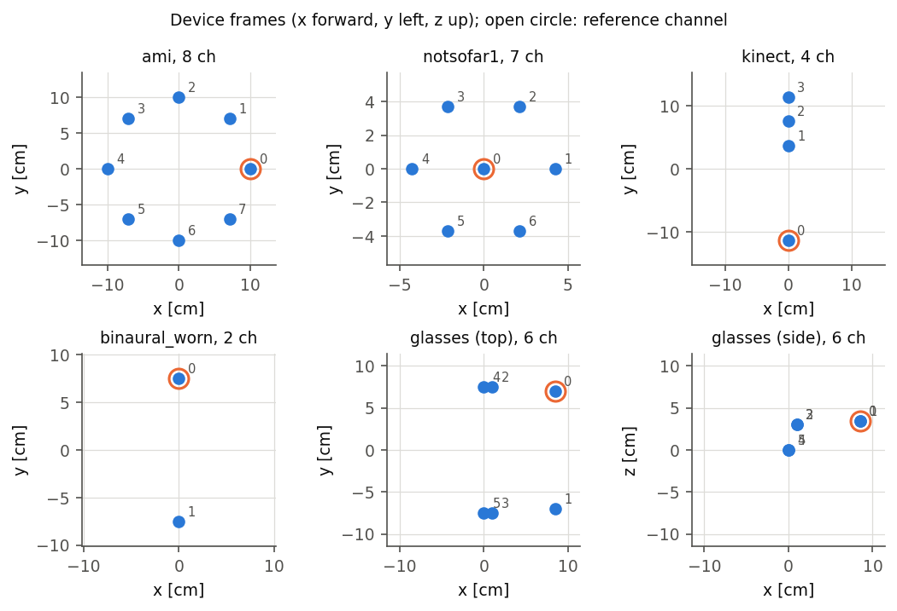

*Figure 1. Microphone offsets of the presets in the device frame. The open
circle marks the reference channel. The glasses are shown from above and from
the side.*

| Preset | Channels | Placement | Geometry |
|--------|----------|-----------|----------|
| `single` | 1 | free | one omnidirectional mic |
| `circular` | `n_mics`, plus 1 if `center_mic` | table | circle of radius `radius` |
| `ami` | 8 | table | circle, 10 cm radius |
| `notsofar1` | 7 | table | 6 on a circle and 1 at the center; radius approximate |
| `kinect` | 4 | wall | linear, Kinect v1 capsule positions; approximate for Kinect v2 |
| `binaural_worn` | 2 | head | in-ear pair as in CHiME-6 |
| `glasses` | 6 | head | 4 on the frame and 2 in-ear, after EasyCom; positions approximate |
| `closetalk` | 1 per talker | mouth | headset mic in front of each talker's mouth |

Table placements put the array at a random point in the central 40% of the
room length and width, with a random yaw. Wall placements put it 0.1 to 0.5 m
from a random wall, facing into the room. Head placements attach
the device to a wearer seat (see below). Every field of a preset can be
overridden in the device entry, for example
`{preset: circular, n_mics: 6, radius: 0.05}`. Microphones can be directional
through `mic_pattern` and `mic_orientation`.

When several devices are listed, each device produces its own recording,
named `<meeting id>_<device>`. All recordings of a meeting share the same
timeline and the same sources.

## Room model

Stage 3 (`fastmss/spatial/scene.py`) draws a shoebox room per `room_<id>`
with dimensions from `room_sz` and `room_ceiling` and an RT60 from `rt60`.
pyroomacoustics then computes RIRs from a fixed set of source positions to
every microphone of every device. The positions are:

- talker nodes, `n_pos_rirs` per room, at a height drawn from `node_height`
  and at least `min_dist_device` from the fixed devices;
- walking paths between pairs of nodes, sampled every `traj_step` m, with
  `n_trajectories` paths of length `traj_len` per room;
- wearer seats, `n_wearer_seats` per room, each with `n_yaw` head-yaw bins and
  one mouth position per bin;
- noise sources, `noise.n_sources` (4 by default), one per room corner at
  `noise.corner_dist` m from both walls.

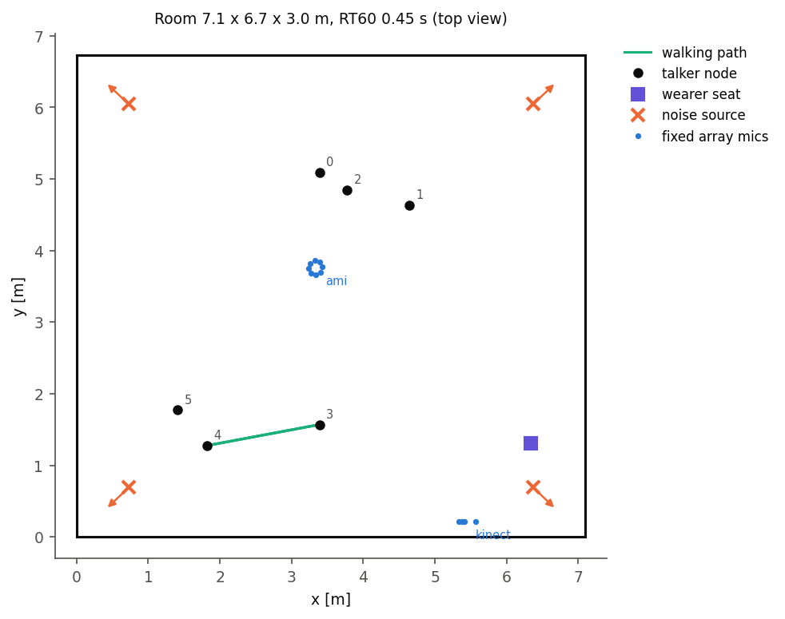

*Figure 2. Top view of a generated room: talker nodes, walking paths, the
wearer seat, the fixed arrays and the corner noise sources with their
orientation.*

For each position the bank stores the reverberant RIR and the direct-path RIR
(`max_order=0`) of every channel. The banks are written to
`rirs/room_<id>/<device>.npy` and `<device>-direct.npy`, with the geometry in
`scene.json`. RIRs are truncated to `rir_max_len` s and stored as
`rir_dtype`.

The bank size is the product of devices, mic poses, source positions,
channels and RIR length. Stage 3 logs the expected size before it starts.
Worn devices are the largest term, because each seat and head-yaw bin is a
separate mic pose.

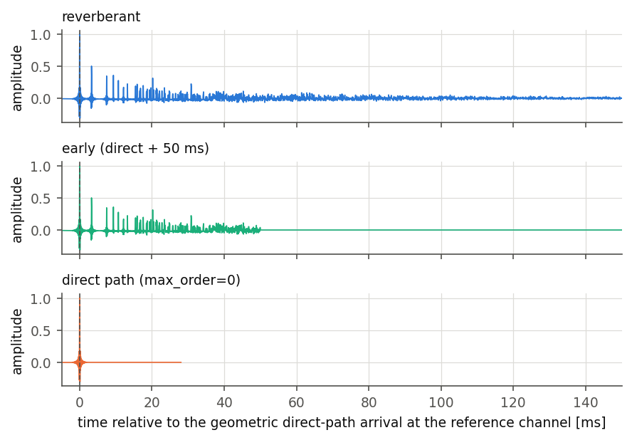

*Figure 3. Reverberant, early and direct-path RIR from one node to the
reference channel of the AMI array. Time 0 is the geometric direct-path
arrival.*

The median RT60 estimated with Schroeder integration over the nodes of the
figure room is 0.49 s. The target drawn for the room was 0.45 s.
`tests/test_acoustics.py` checks the estimate against the target over several
rooms.

## Directional talkers and microphones

Talkers use one of the analytic patterns of pyroomacoustics, selected by
`source_directivity.pattern`: `omni`, `subcardioid`, `cardioid`,
`hypercardioid` or `figure8`. Directivity depends on the facing direction, so
each node is stored with `source_directivity.n_orient` yaw bins. A talker uses
the bin closest to the direction it faces. The facing direction is set by
`face`: toward the centroid of the other talkers (`group`), toward the first
fixed device (`device`) or random.

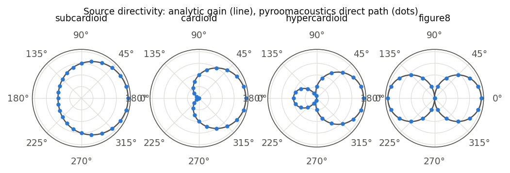

*Figure 4. Direct-path gain of a source rotated in 15 degree steps in an
anechoic room (dots), and the analytic pattern (line).*

The largest absolute difference between the two in Figure 4 is below
2e-7 for all four patterns.

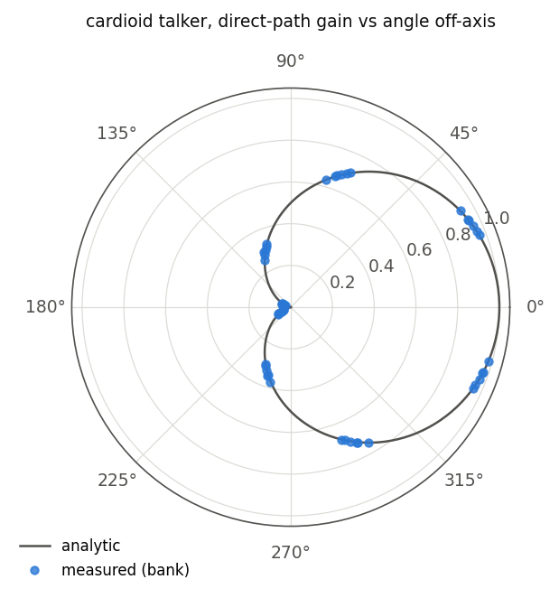

*Figure 5. Direct-path gain stored in the bank for every node and yaw bin of a
cardioid talker, plotted against the angle between the talker axis and the
direction of the microphone.*

Figure 5 checks the bank itself: every stored entry lies on the analytic
cardioid. The same check runs in `tests/test_directivity.py`.

## Motion

Motion is set in `spatial.motion` and implemented in
`fastmss/spatial/motion.py`. It has three parts.

Between utterances (`inter`), a talker either takes a random node at each
utterance (`random`), keeps its first node (`static`), or moves to a node
within `max_position_change` m, with closer nodes more likely
(`random_walk`).

Within an utterance (`intra`), with probability `move_prob`, a talker walks
along a precomputed path at a speed drawn from `speed_range` (`walk`), turns
by an angle drawn from `rotate_range` (`rotate`), or does both
(`walk_rotate`). With `none`, talkers do not move during an utterance.

A worn device follows the head of its wearer. At each turn the wearer looks
toward the active talker with probability `head_turn_prob`, with a random
offset of up to `head_jitter` degrees. The head yaw moves through the
precomputed yaw bins. With `wearer: speaker` the wearer is one of the talkers,
and the mouth position turns with the head. With `wearer: listener` the wearer
does not talk, and no talker is placed on the wearer seat.

## Time-varying convolution

A moving source or microphone is rendered with the method of the
pyroomacoustics discussion on moving sources: the signal is split in time with
overlapping triangular windows, each piece is convolved with the RIR of the
nearest waypoint, and the results are summed. The code is in
`fastmss/spatial/render.py`.

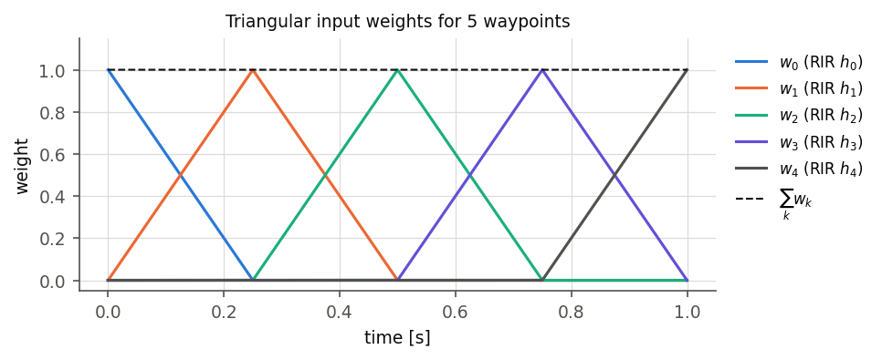

*Figure 6. Weights for five waypoints. Each weight is 1 at its waypoint and 0
at its neighbours. The weights sum to 1 at every sample.*

Because the weights sum to 1, a source with a single waypoint is rendered by a
plain convolution, the same operation as in the single-channel path.

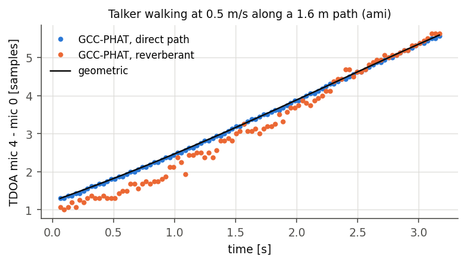

*Figure 7. Time difference of arrival between two mics of a fixed array for
white noise moved along a 1.6 m path at 0.5 m/s. Dots: GCC-PHAT on the rendered
signals. Line: TDOA computed from the geometry.*

The median absolute TDOA error along the path is 0.02 samples for the
direct-path rendering and 0.22 samples for the reverberant one.

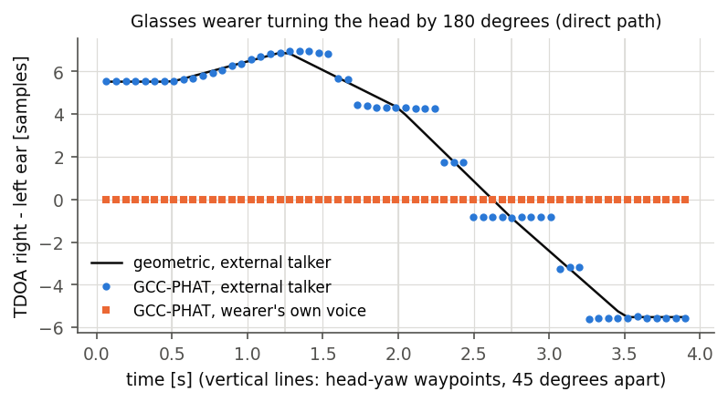

*Figure 8. TDOA between the in-ear mics of a glasses wearer who turns the head
by 180 degrees in 45 degree steps. Circles: an external talker. Squares: the
wearer's own voice.*

For the external talker the TDOA follows the head yaw, with a median error of
0.10 samples. The wearer's own mouth turns with the head, so its TDOA does not
change (peak-to-peak 0 samples).

Interpolating between RIRs `traj_step` m apart can add comb filtering at high
frequencies while a source moves. A smaller `traj_step` reduces it and
increases the bank size.

## Reference signals

For each utterance the code computes the geometric direct-path delay from the
talker to the reference channel at the utterance start. The reference channel
is `reference.channel`, or the device's `ref_channel` when this is `null`.
For close-talk devices it is the talker's own headset. Every channel of the
utterance is shifted earlier by this delay, so that the direct sound at the
reference channel starts at the supervision start. All channels share the
shift, so the delays between channels are kept.

With `save_spk` and `save_anechoic` the following images are written per
talker:

- `-spk-<speaker>.wav`: reverberant image;
- `-spk-<speaker>-anechoic.wav`: direct-path image (`max_order=0`);
- `-spk-<speaker>-early.wav`: direct path plus the first `early_ms` ms of the
  RIR.

`reference.type` selects `direct`, `early` or `both`. `reference.dump: ref`
writes the reference channel only, and `reference.dump: all` writes every
channel.

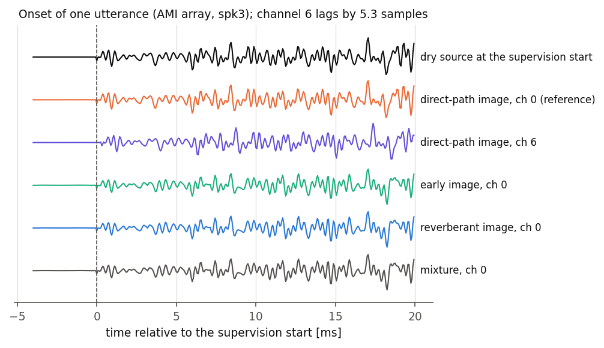

*Figure 9. Onset of one utterance on the AMI array. From top: the dry source
placed at the supervision start, the direct-path image on the reference
channel and on the farthest channel, the early and reverberant images and the
mixture on the reference channel.*

GCC-PHAT between the dry source and each image on the reference channel gives
a lag of -0.125 samples for the direct, early and reverberant images. The
estimated lag between the farthest channel and the reference channel is 5.31
samples. The geometric value is 5.32 samples.

`tests/test_dump_alignment.py` checks that:

- the images are aligned to the dry source on the reference channel;
- the reverberant images of all talkers sum to the mixture without noise;
- the `ref` files equal the reference channel of the `all` files for the same
  seed.

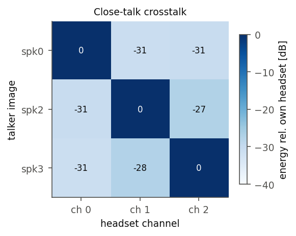

*Figure 10. Energy of each talker's image on every headset, relative to the
talker's own headset.*

On close-talk devices each talker is at least 27 dB louder on their own
headset than on any other headset in Figure 10. `tests/test_levels.py`
requires at least 20 dB, with static, walking and turning talkers.

## Noise

With `noise.type: mono` the noise clip is added to every channel, as in the
single-channel path. With `noise.type: diffuse` the clip is played through the
corner sources. These have a `noise.pattern` directivity (hypercardioid by
default) and face the corner, so most of the energy reaches the microphones
after reflection.

`noise.signal` sets what the corner sources play. With `same`, every source
plays the same clip. With `shifted`, each source plays a copy of the clip
shifted in time.

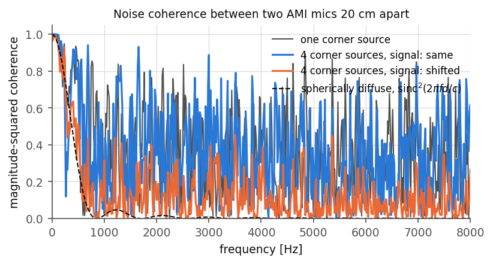

*Figure 11. Magnitude-squared coherence between two AMI mics 20 cm apart for
one corner source, for four sources with `same` and `shifted` signals, and
for an ideal spherically diffuse field.*

Mean coherence between 300 Hz and 4 kHz:

| Noise field | Mean coherence |
|-------------|----------------|
| one corner source | 0.37 |
| 4 sources, `same` | 0.40 |
| 4 sources, `shifted` | 0.15 |
| spherically diffuse (theory) | 0.04 |

The same signal through four fixed filters is still one coherent source, so
`same` is not more diffuse than a single corner source. `shifted` lowers the
coherence. Neither reaches the ideal diffuse field.

The noise level is set as in the single-channel path: the level at the
reference channel is the lowest speech level plus a value drawn from
`noise_rel_gain`. `tests/test_levels.py` checks the level to within 0.01 dB.

## Supervisions

Each supervision has a `custom.spatial` field with the device, the start and
end position of the talker, whether the talker moved or turned during the
utterance, the start yaw and, for close-talk devices, the talker's headset
channel.

## Limitations

- Talkers walk only along the precomputed paths.
- Wearers stay on their seat for the whole meeting.
- A walking talker's close-talk headset uses the position precomputed for the
  nearest node and yaw bin.
- The `notsofar1` radius and the `glasses` mic positions are approximate.

## Tests

```bash
python -m pytest tests/
```

| File | Checks |
|------|--------|
| `test_legacy.py` | single-channel output is bit-identical to the baseline |
| `test_render.py` | time-varying convolution, weights, static case |
| `test_gccphat.py` | GCC-PHAT TDOA and SRP-PHAT DOA against geometry, for static and moving talkers and turning heads |
| `test_directivity.py` | source and mic patterns, orientation bins in the bank, DRR facing and away |
| `test_acoustics.py` | direct-path delay, RT60, noise coherence |
| `test_dump_alignment.py` | reference alignment, sum to the mixture, `ref` against `all` |
| `test_levels.py` | close-talk crosstalk, noise level, speech levels, `wearer: listener` |
| `test_devices.py` | presets and device geometry |
| `test_motion.py` | motion strategies, walking paths, wearer head schedule |

`tests/plot_scene.py <scene.json>` draws Figures 2, 5 and 7 for an existing
bank.
